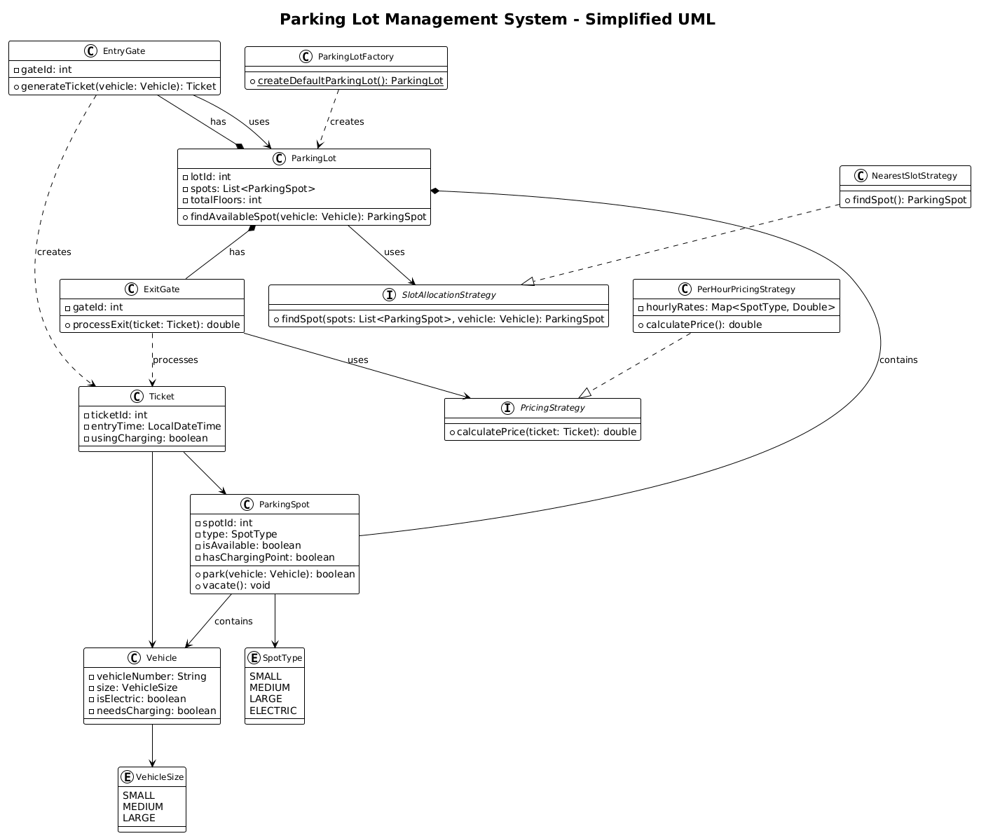

# Parking Lot - Low Level Design Assignment

A simplified implementation of a Parking Lot Management System demonstrating key design patterns and object-oriented principles.




## Features

- **Multi-Floor Parking**: Support for multiple floors with different spot types
- **Vehicle Types**: Small (Bikes), Medium (Cars), Large (Buses)
- **Electric Vehicle Support**: Special spots with charging capabilities
- **Pricing Strategy**: Per-hour pricing based on vehicle size and charging usage
- **Spot Allocation**: Nearest available spot allocation strategy
- **Entry/Exit Gates**: Multiple gates for vehicle entry and exit

## Design Patterns Used

1. **Strategy Pattern**: For pricing and spot allocation strategies
2. **Factory Pattern**: For creating parking lot configurations
3. **Builder Pattern**: For flexible parking lot construction
4. **Observer Pattern**: For spot availability notifications

## Project Structure

```
├── src/
│   ├── enums/
│   │   ├── VehicleSize.java
│   │   └── SpotType.java
│   ├── models/
│   │   ├── Vehicle.java
│   │   ├── ParkingSpot.java
│   │   ├── ParkingLot.java
│   │   ├── Ticket.java
│   │   ├── EntryGate.java
│   │   └── ExitGate.java
│   ├── strategies/
│   │   ├── SlotAllocationStrategy.java
│   │   ├── NearestSlotStrategy.java
│   │   ├── PricingStrategy.java
│   │   └── PerHourPricingStrategy.java
│   ├── factory/
│   │   └── ParkingLotFactory.java
│   └── Main.java
└── README.md
```

## How to Run

1. Compile the Java files
2. Run the Main class
3. Follow the interactive menu to park/exit vehicles

## Key Components

### Vehicle Management

- Vehicle identification and size classification
- Electric vehicle support with charging preferences

### Spot Management

- Different spot types (Small, Medium, Large, Electric)
- Availability tracking and allocation
- Charging point support for electric vehicles

### Pricing System

- Configurable hourly rates per spot type
- Additional charging fees for electric vehicles
- Time-based calculation

### Gate Management

- Multiple entry and exit points
- Ticket generation and validation
- Integrated with allocation strategy

This implementation provides a solid foundation for a parking lot management system while keeping the code clean and maintainable.
